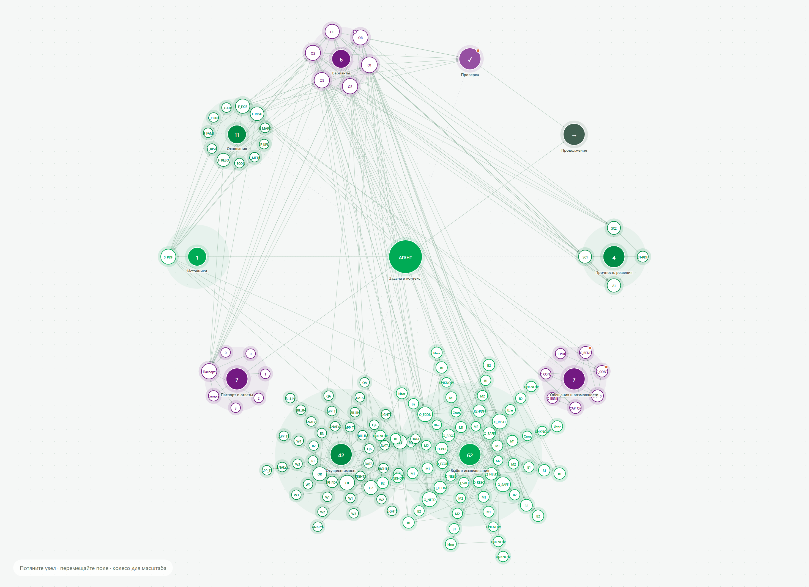
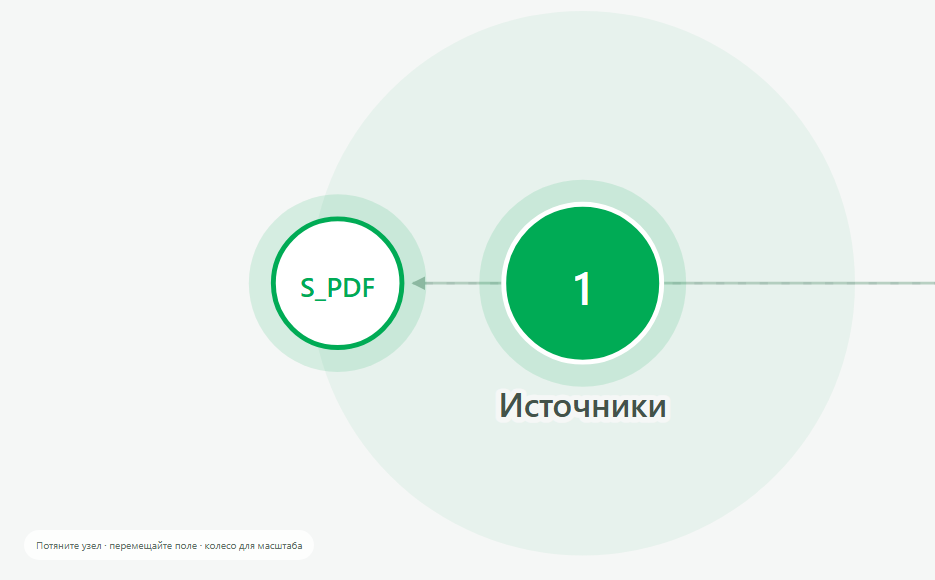
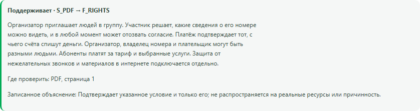
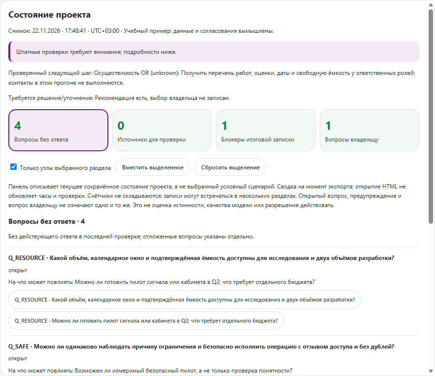
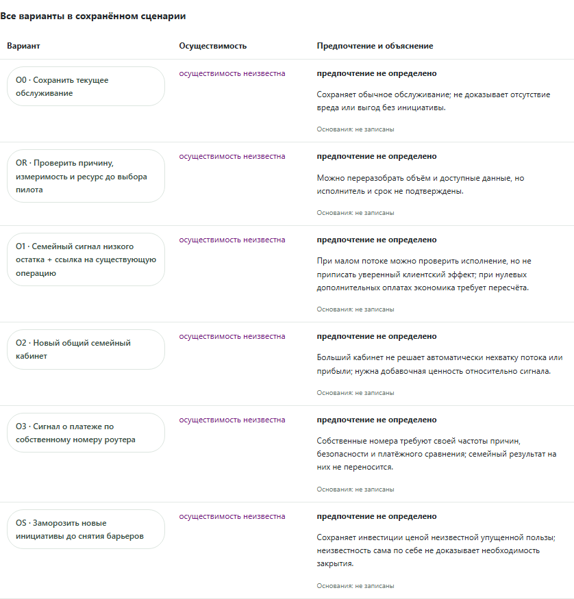
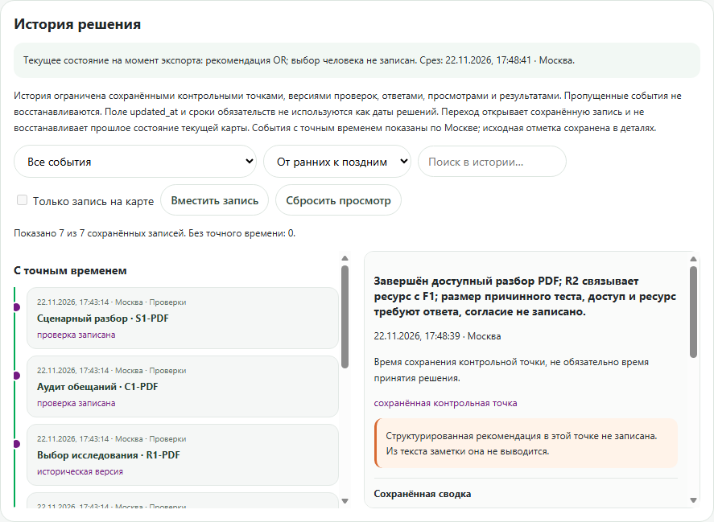

# Контур решения

## Визуальная карта проекта



**Весь граф целиком:** все группы раскрыты, фильтры сняты. Сплошные линии показывают записанные связи,
пунктир — навигационную группировку. Это карта сохранённых оснований, а не скрытых рассуждений модели.
[Открыть в полном разрешении](docs/screenshots/agent/00-full-graph.png), чтобы рассмотреть отдельные узлы.
Все снимки в README получены из чата **«Прогон 3 — проверка последней версии…»**, из разбора файла **«Пример брифа.pdf»**
о вымышленном мобильном операторе. Это результаты анализа учебного брифа, не реальные результаты пилота.

### Крупный план: источники

<picture>
  <source media="(max-width: 600px)" srcset="docs/screenshots/agent/01-overview-mobile.png">
  
</picture>

Агент связывает задачу с материалами, выводами, альтернативами и проверками. На снимке раскрыта группа источников; остальные группы свёрнуты.
Пунктир служит навигации и не является доказательством зависимости или причинности.
Источник — предоставленный PDF; факты о его содержании отделены от гипотез о клиентской пользе.

[Локальное открытие интерактивной карты](docs/visualization.md):
`python scripts/visualize.py <путь-к-кейсу>/project.json --out work-graph.html`, затем откройте HTML в браузере.
Исходные PDF, JSON и HTML прогона не публикуются; в README размещены только снимки выбранных представлений.
[Как получены снимки](docs/screenshots/agent/README.md).

**Допуск к финальной записке:** `audit --ready --quality` и `report --final`
проверяют обязательный сценарный разбор и применимость ресурсной проверки.
Отсутствующая процедура блокирует итоговый экспорт; черновик остаётся доступен
в рамках существующих проверок источников. Примеры отдельных функций не
объявляются полным прохождением workflow: `python scripts/verify_required_procedures.py`
проверяет их ожидаемые блокеры. Положительный путь полной готовности и отказ
при пропуске разделов покрыты регрессионными тестами.

**Проверяемые развилки исследования:** [инструкция](docs/research-decision-branches.md),
[авторский пример](examples/research-branches-case/README.md). Для каждого ответа
видны условие выбора, основание, следующий шаг и отдельный исход «данных недостаточно».
Проверка: `python scripts/verify_branch_demo.py`.

**Осуществимость отдельно от разрешения:** [инструкция](docs/feasibility-check.md).
Агент сопоставляет минимальные работы, компетенции, подтверждённую ёмкость и
календарные зависимости. Неизвестная трудоёмкость не становится дефицитом.
Проверка: `python scripts/verify_feasibility_demo.py`.

**После решения:** [инструкция](docs/decision-follow-up.md),
[вымышленный пример](examples/decision-follow-up-case/README.md). При открытии
видны согласованные просрочки, новые результаты и вопросы для человека.
Проверка: `python scripts/verify_follow_up_demo.py`.

**Что исследовать дальше:** [инструкция](docs/next-research-selection.md),
[учебный пример](examples/next-research-case/README.md). Агент сравнивает пробелы
по влиянию на решение, объясняет следующий шаг и условие остановки исследования.
Проверка: `python scripts/verify_research_demo.py`.

**Аудит маркетинговых обещаний:** [инструкция](docs/marketing-claims-audit.md),
[учебный пример](examples/marketing-claims-case/README.md). Возможность продукта
отделена от подтверждённого эффекта; отсутствие доказательств не называется ложью.
Проверка: `python scripts/verify_claims_demo.py`.

**Проверка решения на прочность:** [инструкция](docs/decision-stress-test.md),
[учебный пример](examples/decision-stress-case/README.md). Агент сравнивает
неблагоприятные сценарии, показывает условия смены рекомендации и сохраняет
версии разбора. Проверка: `python scripts/verify_stress_demo.py`.

**Доработка после живых прогонов:** [что исправлено](docs/local-quality-upgrade.md), [содержательная проверка](workflows/decision-review.md), [сверка с конкурсом](docs/contest-fit.md). Новый строгий пример: `examples/review-contract-case`.

Начните с [START_HERE.md](START_HERE.md). Единый запуск: `python scripts/start.py examples/campus-strategy/project.json`. [Улучшения после проверки в новом чате](docs/agent-v3.md).

**Обновление 14 ноября.** Добавлен [быстрый запуск](docs/quickstart.md),
[второй сквозной кейс](examples/campus-strategy/README.md), структурный аудит
стратегии, чтение локальных источников, блокировка экспорта при устаревших
основаниях и журнал известных/неизвестных расходов. Материалы для заявки:
[описание и сценарий видео](docs/submission.md).

```text
python -m unittest discover -s tests -v
python scripts/verify_demo.py
python scripts/project_tool.py audit examples/campus-strategy/project.json --ready
```

Новый кейс — самостоятельная тренировка на материалах «Зачёта», открытых
страницах и синтетической таблице, **не официальный демонстрационный бриф
МегаФона**. В прочитанном 14 ноября задании указано, что отдельный бриф
опубликуют дополнительно. Первоначальный A/B-кейс ниже сохранён как отдельный
пример аналитики. Сравнение качества с обычным чатом ещё не проводилось.

Агент для руководителя цифрового продукта: от размытого бизнес-вопроса к проверяемому исследованию, альтернативам, продуктовой и коммуникационной стратегии и плану проверки.
Репозиторий ИИ-агента для руководителя цифрового продукта. Агент ведёт от размытого запроса к проверяемой картине ситуации, минимум трём содержательно разным вариантам (включая «оставить как есть» и «закрыть»), согласованным продуктовой и коммуникационной стратегиям и плану проверки.

Это не программа и не автономный сервис. Это папка с инструкциями, методиками, состоянием задачи и небольшими инструментами на Python stdlib. Её открывают в **Claude Code, Cursor или Codex**: модель работает по `AGENTS.md`, а расчёты, снимки источников, журнал и проверки выполняют скрипты.

## Быстрый старт (3 шага)

1. **Откройте папку** в Claude Code, Cursor или Codex. Нужен только Python 3.10+; ключи, `pip install` и скрытые настройки не требуются. Claude Code подхватит `CLAUDE.md`, скиллы, субагентов и hooks; Cursor — `.cursor/rules/agent.mdc`; Codex — `AGENTS.md`.
2. **Проверьте, что всё работает:**
   ```bash
   python3 -m unittest discover tests            # 13 тестов: валидатор, журнал, снимки, hooks, checkpoint
   python3 scripts/checkpoint.py examples/operator-subscription-case/project.json resume
   ```
3. **Дайте задачу агенту:** «Новый проект: <размытый вопрос>. Веди меня по workflow». Или: «Продолжи кейс operator-subscription-case». Агент создаст `projects/<slug>/project.json` и будет останавливаться для вашего выбора в существенных точках.

## От источника к выводу

<picture>
  <source media="(max-width: 600px)" srcset="docs/screenshots/agent/02-evidence-mobile.png">
  
</picture>

В «Пути решения» видны не только связанные узлы: агент сохраняет фрагмент источника, его точное место
и объяснение того, какую часть вывода он поддерживает. Здесь фрагмент PDF показывает, что организатор,
владелец номера и плательщик могут быть разными людьми; согласие можно отозвать, а оплату подтверждают отдельно.
Это записанное обоснование ограничений сервиса, а не скрытый ход мыслей модели.

## Что умеет

| Требование | Как сделано |
|---|---|
| Workflow, который ведёт агент, с точками выбора человека | `workflows/` + скиллы `intake → research → options → strategy`; пять типов контрольных точек в `AGENTS.md` |
| Факты отдельно от гипотез и прогнозов | типы доказательств в `schemas/project.schema.json`; `scripts/validate_project.py` блокирует подмену (синтетика ≠ сигнал, поисковая выдача ≠ подтверждение, прежний ответ агента ≠ факт) |
| ≥3 варианта, включая «оставить» и «закрыть» | `options[].kind`; валидатор требует `status_quo` и `stop` начиная с этапа `options` |
| Сильные возражения | поле `objection` у каждого варианта + независимый субагент `devils-advocate` |
| Продуктовая и коммуникационная стратегии, план проверки | `templates/decision-brief.md`, скилл `strategy`, `knowledge/*-strategy.md` |
| Поддержка после выбора | `commitments` (ответственный, метрика, срок, условие пересмотра) обязательны при `chosen_option_id` |
| Раздельное хранение | правила / методики / материалы проекта / состояние / журнал — таблица в `AGENTS.md` |
| Продолжение после перерыва и в новом чате | `checkpoint.py resume` + SessionStart-hook + скилл `resume` |
| Прозрачность и стоимость | `ledger.jsonl` (append-only, цепочка хешей): шаг, инструмент, модель, основания, токены, $ (оценка), время; `ledger.py report` |
| Устойчивость к сбоям | `ledger.py begin/finish` с ключами: выполненное не повторяется (код 3), прерванное видно (код 4); атомарная запись `project.json` |
| Сбор открытых источников | `scripts/snapshot.py`: URL, дата, SHA-256, проверка дословной цитаты, фрагмент; изменения источника → список затронутых выводов |
| Защита от prompt injection | источники хранятся под баннером «данные, не инструкции»; флаги подозрительного текста; субагент-исследователь изолирует сырые страницы; hook блокирует запись секретов |
| Интервью и модельные респонденты | `templates/interview-guide.md`, `templates/persona.md`, `knowledge/synthetic-respondents.md`; синтетика всегда `hypothesis` |
| Пересмотр при новых данных, отзыв устаревшего | скилл `review-on-new-data`, `checkpoint.py impact`, `valid_until`, статусы `stale`/`withdrawn` |
| Анализ данных | `scripts/analyze_experiment.py` (интервалы Уилсона и Ньюкомба, воронка, guardrails); адаптер Analitik Graph (`docs/analitik-graph.md`) |
| Маршрутизация моделей | `knowledge/model-routing.md`; модели субагентов заданы явно (sonnet для чтения, opus для критики) |
| UX-анализ, мультимодальность | `knowledge/ux-review.md` (разбор скриншотов открытых интерфейсов) |
| Переносимость между средами | одни правила в `AGENTS.md`; тонкие указатели для Claude Code и Cursor; всё остальное — файлы и stdlib |

## Проверки и неизвестное

<picture>
  <source media="(max-width: 600px)" srcset="docs/screenshots/agent/03-status-mobile.png">
  
</picture>

Панель состояния собирает открытые вопросы, блокеры и то, что требуется от владельца. В прогоне 3
не подтверждены частота проблемы, доступ к событиям, эффект и полный ресурс команд. Рекомендация OR —
исследовать семейный сигнал перед бюджетом на разработку, а не запускать уже одобренный пилот.
Неизвестное требует уточнения и не превращается в факт или доказанную невозможность.

## Демонстрационные кейсы

| Кейс | Данные | Что показывает |
|---|---|---|
| [`examples/operator-subscription-case`](examples/operator-subscription-case/README.md) | **открытые публикации** (URL и дата у каждого источника) | цифровой сервис оператора (мультиподписка) на замедляющемся рынке: 11 источников, 14 доказательств (включая противоречие), 5 вариантов, модельные респонденты, критика, записка со стратегиями, журнал стоимости. Это **каркас**: сеть в сессии подготовки была закрыта, поэтому источники — из поисковой выдачи, и список снимков, которые нужно сделать, приложен |
| [`examples/activation-case`](examples/activation-case/README.md) | синтетика (детерминированный генератор) | анализ A/B-теста по связанным таблицам без раздувания числа клиентов; интервалы; почему «интервал включает ноль» не означает «победителя» |

```bash
python3 scripts/generate_demo.py && python3 scripts/analyze_experiment.py   # воспроизводит кейс 1 байт в байт
python3 scripts/ledger.py report examples/operator-subscription-case/project.json
```

Когда МегаФон опубликует бриф демо-проекта, используйте скилл `adapt-brief`: он переносит структуру кейса и не переносит его факты и синтетику.

## Сценарии: что изменится при ухудшении условий

<picture>
  <source media="(max-width: 600px)" srcset="docs/screenshots/agent/04-scenarios-mobile.png">
  
</picture>

Агент сравнивает все альтернативы при неблагоприятном условии и показывает основания оценок.
Здесь рассматриваются малый поток наблюдений и неподтверждённый ресурс QA. Это **условный сценарий**:
его оценки не применяются автоматически к реальной рекомендации или выбору владельца.

## Карта файлов

```text
AGENTS.md                  постоянные правила агента (общие для всех сред)
CLAUDE.md                  указатель для Claude Code (импортирует AGENTS.md)
.claude/skills/            8 повторяемых процедур: intake, research, synthetic-respondents, options,
                           strategy, resume, review-on-new-data, adapt-brief
.claude/agents/            2 субагента: source-researcher (изоляция веб-страниц, дешевле),
                           devils-advocate (независимая критика, только чтение)
.claude/settings.json      разрешения и hooks (SessionStart, PreToolUse, PostToolUse, Stop)
.cursor/rules/agent.mdc    указатель для Cursor
workflows/                 этапы и условия перехода
knowledge/                 методики: стратегия, коммуникация, метрики, источники, синтетика,
                           память и пересмотр, маршрутизация моделей, UX-разбор
schemas/                   формат project.json
templates/                 project-state, decision-brief, evidence, interview-guide, persona
config/model_prices.json   цены моделей для оценки стоимости (с датой проверки)
scripts/                   validate_project, checkpoint, ledger, snapshot, generate_demo,
                           analyze_experiment; hooks/ — скрипты hooks Claude Code
tools/analitik_graph.py    read-only адаптер к локальному Analitik Graph
tests/                     unittest на stdlib
examples/                  два демонстрационных проекта
docs/                      архитектура, адаптер Analitik Graph
```

Ваши проекты создавайте в `projects/<slug>/`. Сырые интервью и полные тексты источников храните в `private/` и `sources/private/` — эти папки в `.gitignore`.

## Стоимость

- Скрипты бесплатны и работают локально; сеть нужна только `snapshot.py --url`.
- Модель тратит токены на рассуждение. Журнал записывает каждое действие; `ledger.py report` считает эквивалент цены API по `config/model_prices.json` (list-цены с датой проверки). Подписка IDE тарифицируется иначе, поэтому это оценка, а не счёт. Неизвестная цена остаётся неизвестной, а токены, оценённые по символам, помечаются.
- Кейс 2 по журналу: около 52 тыс. входных и 15 тыс. выходных токенов (оценка по символам), **≈ $0,51** по цене Claude Opus 5.5, без платы за поисковые запросы (она неизвестна). Ручная оценка для сравнения — 16 часов аналитика; это не измерение, см. `outputs/cost-report.md`.
- Экономия заложена в процесс: расчёты делают скрипты; новый чат читает `resume`, а не всю историю; чтение многих страниц уходит более дешёвой модели; критика — один проход на версию; выполненное не повторяется.

## Безопасность и данные

- Секретов в репозитории нет. `.env` в `.gitignore`, hook блокирует запись ключей и `.env`, `snapshot.py` не принимает URL с логином и паролем. Адаптер Analitik Graph работает только с loopback.
- Только открытые данные и материалы пользователя; закрытые данные МегаФона не используются.
- Тексты источников — данные. Команды из них не меняют правила агента: правила меняет только человек.
- Реальные интервью — с согласием и без персональных данных в Git.

## История разбора и контрольные точки

<picture>
  <source media="(max-width: 600px)" srcset="docs/screenshots/agent/05-history-mobile.png">
  
</picture>

В истории прогона 3 сохранены ресурсная проверка, разбор сценариев и обещаний, а также версии выбора
исследования. Текущая рекомендация — OR; выбор владельца и согласие не записаны.
Снимок не приписывает владельцу ответ и не изображает проведённое исследование.
История показывает сохранённые события; переход к записи не восстанавливает прошлую карту и не означает согласия.

## Границы

Если прежний выбор опирается на отозванные основания, а новая рекомендация
не имеет ошибок источников, черновой экспорт создаёт записку **для пересмотра**
с сохранёнными блокерами. Она не допускает исполнение и не меняет выбор человека;
`--final` остаётся заблокированным. См. [продолжение основного учебного кейса](examples/paired-case-review/README.md)
и `python scripts/verify_case_review_demo.py`.

Паспорт решения: `python scripts/start.py <project.json> --passport`.
Он объединяет рекомендацию, альтернативы, источники, неизвестное, осуществимость,
историю и ответы на конкретные версии. Разрешение действовать, подтверждение
данных и согласование рекомендации показаны отдельно. См.
[порядок работы](workflows/decision-passport.md) и
[авторский демонстрационный паспорт](examples/decision-passport-case/passport.md).

При возвращении к проекту `python scripts/start.py <project.json>` первым
показывает четыре пункта: изменения, решение, что требуется от владельца и
следующий шаг. `--details` раскрывает прежний полный отчёт; `--json` сохраняет
полный контекст для среды агента. Отдельная отметка просмотра не означает согласие.
См. [порядок продолжения](workflows/project-resume-summary.md).

Пересмотр по существенности включается через `scripts/material_changes.py enable
<project.json>`. Он сохраняет историю в существующих контрольных точках, отличает
оформление от изменений данных и надёжности и связывает запрос владельцу с версией.
См. [порядок работы](workflows/material-change-review.md). Проверка:
`python scripts/verify_material_changes_demo.py`. Это авторская демонстрация
поведения файлового агента, не испытание качества ответов модели.

Агент не заменяет владельца продукта, исследователя, юриста, службу безопасности и статистика. Синтетика и поисковая выдача не доказывают спрос. Наблюдательные различия не являются причинным эффектом. Скрипт анализа не выдаёт p-values и решения о запуске. Перед сдачей адаптируйте демо под официальный бриф и запишите видео сквозного пути. Подробнее — [архитектура](docs/architecture.md).
