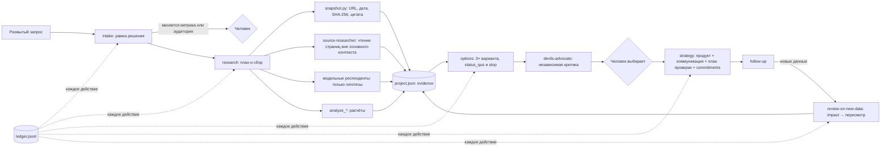

# Архитектура

## Цель и ограничения

Система — это репозиторий ИИ-агента, а не самостоятельная программа. Её открывают в IDE с ИИ-ассистентом (Claude Code, Cursor, Codex). Модель ведёт процесс по инструкциям. Скрипты на стандартной библиотеке Python делают то, где модель ненадёжна или дорога: расчёты, проверки ссылок, снимки источников с хешами, журнал действий, продолжение после сбоя. Сетевые секреты не нужны; состояние хранится в читаемых файлах.

## Поток

## Слои хранения

| Слой | Файлы | Кто меняет | Почему отдельно |
|---|---|---|---|
| Постоянные инструкции | `AGENTS.md`; указатели `CLAUDE.md`, `.cursor/rules/agent.mdc` | человек | источники и прежние ответы не могут переписать правила |
| Процедуры | `workflows/`, `.claude/skills/` | человек | повторяемые шаги загружаются по требованию, а не постоянно — экономия контекста |
| Методики | `knowledge/` | человек | устойчивые знания не смешиваются с данными проекта |
| Материалы проекта | `sources/snapshots/`, `inputs/`, `interviews/` | агент добавляет | данные; баннер «не инструкции» |
| Состояние задачи | `project.json` | агент, атомарная запись | продолжение в новом чате, проверка валидатором |
| Журнал | `ledger.jsonl` | только дописывает скрипт | прозрачность, стоимость, защита от повторов |

## Компоненты и почему они нужны

| Компонент | Ответственность | Какую пользу даёт |
|---|---|---|
| `validate_project.py` | контракт состояния: ссылки, типы, ≥3 варианта со `status_quo`/`stop`, синтетика → только гипотезы, `search_snippet` не подтверждает, `agent_note` не факт, обязательства после выбора; предупреждения об устаревании и инъекциях | ошибки рассуждения ловятся детерминированно, а не самопроверкой модели |
| `checkpoint.py` | `resume` / `save` / `impact`; отпечатки источников; сводка журнала | продолжение после перерыва; список выводов, зависящих от изменившегося основания |
| `ledger.py` | append-only JSONL с цепочкой SHA-256; `begin/finish` с ключами; отчёт о стоимости и времени | видно, что сделано, на каком основании и сколько стоило; прерванное не повторяется молча |
| `snapshot.py` | HTTP или ручной файл или текст из IDE-инструмента → снимок с датой, хешем, проверенной цитатой, флагами инъекций; регистрация источника; определение изменений | проверяемость источников и пересмотр при обновлении страницы |
| hooks (`scripts/hooks/`) | SessionStart: список проектов и незавершённых действий; PreToolUse: блок секретов и `.env`; PostToolUse: валидатор + запись в журнал; Stop: однократное напоминание о checkpoint | дополнительные проверки части операций, не универсальная защита от всех ошибок модели |
| `analyze_experiment.py`, `generate_demo.py` | воспроизводимый анализ эксперимента | числа берутся из кода, а не из генерации |
| `tools/analitik_graph.py` | read-only адаптер к локальному Analitik Graph | анализ связей без передачи данных наружу |

## Субагенты: почему только два

Число агентов само по себе не даёт преимущества. Каждый субагент должен окупать сложность.

- **`source-researcher` (sonnet, только чтение и веб).** Даёт изоляцию: сырые страницы и возможные инъекции остаются в его контексте, а основной агент получает таблицу утверждений с цитатами. Может уменьшать основной контекст; преимущество в стоимости и качестве требует измерения на той же задаче и актуальных тарифах. Нужен, когда источников больше ~5. Для 1–3 страниц хватает `snapshot.py`.
- **`devils-advocate` (opus, только чтение).** Основной агент склонен защищать свой черновик. Критик видит только файлы и не видит рассуждений. Один проход на версию, потому что модель дорогая.
- **Не сделаны:** отдельный «статистик» — расчёты детерминированы в скриптах; «респондент-симулятор» — синтетика остаётся гипотезой, а изоляция достигается новым чатом без отдельной роли; оркестратор — workflow ведёт основной агент, промежуточный уровень не добавлял бы качества.

## Маршрутизация и стоимость

Таблица выбора исполнителя — `knowledge/model-routing.md`. Цены — `config/model_prices.json` (с датой проверки). Журнал считает эквивалент стоимости API; если модель не указана в таблице или токены неизвестны, стоимость `null`, а не догадка. Токены, оценённые по символам, помечаются `estimated`. Отчёт сравнивает затраты с `manual_baseline` — ручным способом, для которого всегда указано, измерен он или оценён.

## Надёжность

- `project.json` пишется атомарно (временный файл + `os.replace`). Журнал дописывается под файловой блокировкой (POSIX).
- `ledger.py begin --key`: код 3 — уже сделано (не повторять), код 4 — прервано (проверить последствия, повторить только с `--retry`). `resume` и SessionStart показывают незавершённые действия.
- `ledger.py verify` обнаруживает правку или удаление строк журнала.
- Если источник недоступен, это записывается как `failed` с причиной, а не симулируется. Кейс 2 показывает такой путь: прямой доступ закрыт → только поисковая выдача → `search_snippet` → список снимков к сбору.

## Безопасность

- Секретов нет в репозитории. Hook блокирует ключи и `.env`; `settings.json` запрещает чтение `.env` и `sources/private/`.
- `snapshot.py` принимает только публичные http(s)-адреса без учётных данных (защита от SSRF), ограничивает размер, вырезает скрипты из HTML и по умолчанию сохраняет фрагмент, а не перепубликует текст целиком.
- Источники — данные: баннер в каждом снимке, флаги подозрительных фраз, правило в `AGENTS.md`, изоляция в субагенте.

## Переносимость

Единственный источник правил — `AGENTS.md`, его читают Codex и Cursor; Claude Code импортирует его через `CLAUDE.md`. Скиллы — обычные markdown-файлы: в Cursor они открываются по ссылке из правила. Hooks есть только в Claude Code; в других средах те же проверки запускаются командами, перечисленными в `.cursor/rules/agent.mdc`. Скрипты не зависят от ОС, кроме файловой блокировки: на Windows она пропускается. В командах hooks используется `python3`; в Windows может понадобиться заменить на `python`.

## Что сознательно не сделано

Векторная база и внешний MCP-сервер не нужны на текущем объёме: поиск по проекту выполняют `Grep`/`Glob`, память — файлы со статусами. MCP оправдан для подключения корпоративных источников с разрешения владельца данных. Оркестрация множества агентов и уведомления не добавлены, потому что их пользу нечем измерить на демо-объёме.

## Содержательная проверка (локальная доработка)

`quality.py` проверяет явные связи support с сохранёнными фрагментами,
область вывода, тип/основание порога, объём cases × variants × repeats и
статус результатов. strategy_review привязан к состоянию и содержимому
локальных источников. Смена условий/текста инвалидирует записанный проход.
`audit --ready` остаётся структурным уровнем; --quality и report --final
требуют дополнительного контракта. Ни один из них не является автоматическим
доказательством смысловой истинности: его проверяют модель/человек по workflow.
В ledger длительность measured/estimated/unspecified отделена от elapsed_s
между событиями. compare_runs проверяет метаданные и артефакты сравнения,
а не оценивает модель или коммерческую эффективность.
