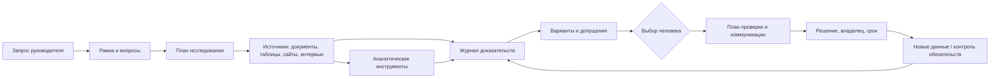

# Архитектура прототипа

## Цель и ограничения

Система — набор инструкций для LLM-ассистента, проектной памяти, локальных инструментов анализа и шаблонов отчёта. Она должна открываться в обычной IDE с ИИ-ассистентом, запускаться без сетевых секретов и сохранять рабочее состояние в читаемых файлах.

Существующий Analitik Graph используется как локальный источник аналитики через адаптер `tools/analitik_graph.py`, а не переписывается и не обязателен для первого демо. Демо-скрипт в этом репозитории показывает тот же принцип: расчёт чисел выполняет детерминированный код, модель объясняет результат и строит решение.

## Поток

## Компоненты

| Компонент | Ответственность |
|---|---|
| `AGENTS.md` | постоянные правила, этапы, маршрутизация, границы |
| `workflows/` | повторяемые процедуры и условия перехода |
| `knowledge/` | устойчивые методики и трактовка evidence |
| проектный JSON | задача, источники, evidence IDs, варианты, состояние и next action |
| CSV/JSON инструменты | генерация синтетического набора, проверка связей/качества, воспроизводимые метрики |
| LLM | выбор следующего действия, запрос уточнения, синтез источников и выводов, черновик стратегий |
| человек | подтверждение рамки и выбор существенной ставки |

## Контракты

- Скрипты не требуют внешнего Python-пакета или API-ключа.
- Каждое свидетельство получает стабильный `id`; рекомендация ссылается на `evidence_ids`.
- Набор связанных таблиц агрегируется к одной строке на `user_id` до сравнения пользовательских метрик. Сырые повторные события и обращения не соединяются напрямую с финансовыми строками.
- Анализатор отдаёт абсолютные доли, разницу, интервал и размер группы. Он не присваивает связи причинный статус.
- `project.json` сохраняет текущий этап и блокер; новый чат может возобновить задачу из файла.

## Надёжность и стоимость

Данные и состояние хранятся локально; API-ключи (если модель вообще требует ключ) задаются в окружении пользователя и не включаются в Git. Каждый вызов внешнего поиска/модели записывается в журнал демонстрации вручную или инструментом среды: поставщик, модель, дата, длительность и оценка стоимости. Если цифра расходов неизвестна, обозначить её неизвестной, а не угадывать.

При сбое инструмента сохранить выполненные шаги, отметить сбой и продолжить работу без молчаливого повторения. При недостатке данных перейти к исследовательскому вопросу или плану сбора данных вместо заполнения пробела догадкой.

## Рост без преждевременной сложности

Сначала один управляющий агент и несколько workflow. В дальнейшем допустим отдельный проверяющий проход или экспертные подагенты по исследованию/статистике, только если на сравнительном прогоне они дают измеримое улучшение качества, времени или стоимости. Хранилище векторной памяти, MCP-коннекторы, уведомления и multi-agent оркестрация не являются предпосылкой MVP.
